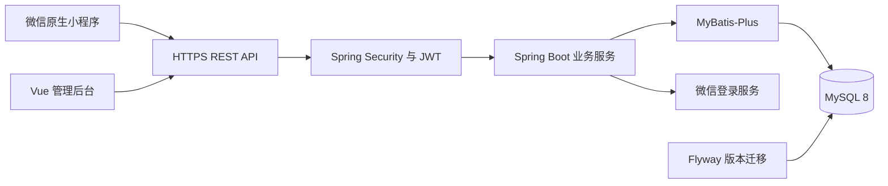

# 总体系统架构设计

## 1. 架构选择

采用单体 Spring Boot 应用和单个 MySQL 8 数据库。管理后台与微信小程序共享 REST API，生产由反向代理提供 HTTPS 和静态资源。暂不引入 Redis、消息队列、服务注册、对象存储或分布式事务。

图中组件为目标设计，当前尚未部署或实现。

## 2. 工程及模块

backend 采用 Maven，后续提供 Maven Wrapper。按 auth、user、laboratory、equipment、reservation、statistics、common 分模块，每个业务模块内部按 controller、service、mapper、entity、dto 分层。控制器负责参数和协议，服务层负责权限范围、事务与状态机，Mapper 负责持久化。查询应在 SQL 中附加范围条件，禁止先返回全部数据再由前端过滤。

admin-web 按登录、实验室、设备、预约审批、账号管理、统计组织页面；路由角色检查用于交互，后端仍执行权限验证。miniapp 包含登录绑定、实验室列表、设备详情及时段、提交预约、我的预约、预约详情。

## 3. 认证链路

后台账号密码登录，BCrypt 验证成功后签发 JWT。微信端以 wx.login 的一次性 code 交由服务端通过 HTTPS 调用微信 jscode2session。已绑定账号返回 JWT，未绑定返回短效一次性绑定凭证，绑定凭证只保存在服务端数据库并存储哈希，有效期 5 分钟。凭证成功使用即删除；不向客户端暴露 session_key、AppSecret 或直接信任客户端 openid。

JWT 使用经过验证的库进行 HS256 签名，密钥至少 256 位，通过环境变量注入；有效期 2 小时，不设计刷新令牌。JWT 包含 sub（账号 ID）、iat、exp、jti，角色和启用状态每次从数据库校验。登出清除客户端令牌，不承诺令牌即时撤销；停用账号可立即阻止后续请求。仅认证接口匿名开放，不使用 Session，Bearer 令牌模式下关闭 CSRF，并限制后台跨域来源。

账号管理不返回密码哈希，微信相关字段仅在认证模块内部使用。演示初始管理员通过安全配置和 BCrypt 创建，不在源码硬编码通用密码。

## 4. 预约事务与并发

所有涉及设备预约、审批、取消、完成、设备状态的写操作使用 InnoDB 事务和 SELECT ... FOR UPDATE。事务采用 READ COMMITTED，冲突检测使用锁定后的当前查询，不依赖普通快照读取。统一锁顺序为：实验室行 → 设备行（多台时按 ID 升序）→ 相关学生账号行（多名时按 ID 升序）→ 预约行。不得在持有后序锁时反向获取前序锁。

创建预约流程：校验认证和参数 → 锁实验室及设备 → 锁学生账号 → 查询同用户幂等键 → 相同内容则返回原记录，否则验证资源、时间和学生有效未结束占用数量 → 查设备冲突 → 插入待审批预约与创建日志 → 提交。相同学生的账号锁保证跨设备并发也不突破 3 条上限。幂等重放在业务重新校验前处理，但仍需本人及有效账号认证。

冲突条件：equipment_id 相同、状态属于 PENDING 或 APPROVED，且 start_time < 新结束、end_time > 新开始。已到开始时间的 PENDING 不再视为有效占用；冲突及配额查询直接排除 start_time <= 当前时间的 PENDING，不在当前事务中跨设备清理其他记录。其持久化过期由定时任务按统一锁顺序逐条处理。设备锁作为同设备请求的共同互斥点，不依赖空结果间隙锁。唯一幂等键约束是重复提交的最后防线。

审批和取消可先只读查预约确定关联 ID，再按上述顺序锁定，并重新读预约和权限状态；关联设备和学生不可修改。审批检查开始时间、前态及设备可用性，状态更新同时带预期旧状态条件；受影响行数不为 1 时返回状态冲突。审计日志与状态同事务提交。实验室停用先锁实验室，再依序锁所有设备并检查未结束占用，设备新增也必须先锁实验室，从而避免遗漏新增资源。

此方案有意采用较粗的实验室锁，同一实验室的写请求短暂串行，适合本项目规模；不同实验室仍可并行。不要把它描述为同实验室设备完全无锁竞争。

数据库死锁或锁等待超时须回滚并返回可重试错误，客户端沿用原幂等键；不无限重试。微信远程请求和其他耗时操作置于数据库锁事务外。

## 5. 定时任务与时间

定时任务每分钟扫描到达开始时间的待审批记录，分批按统一锁顺序处理，锁后再验证前态；单体内运行，不依赖任务准点执行。查询响应按时间判断其有效过期状态，持久化修正通过同一状态服务完成，不能直接在无锁查询逻辑中修改状态。

业务时区固定 Asia/Shanghai，API 使用带 +08:00 偏移的 ISO 8601 字符串，服务端拒绝不符合协议的偏移。数据库 DATETIME(3) 存北京时间，JDBC、应用及数据库连接时区统一设置。后端通过可注入 Clock 提供时间以支持边界测试，不能信任客户端时间。

## 6. 部署与配置边界

开发需 Java 17、Maven、Node.js 长期支持版本、MySQL 8 以及微信开发者工具；具体工具版本在初始化时确认锁定。配置项包括数据库连接、JWT 密钥、微信 AppID/AppSecret、后台允许来源。真实微信联调需 AppID、AppSecret 和符合微信平台要求的 HTTPS 合法域名；缺失时只能验证本地演示认证，不能宣称微信联调通过。

生产规划为 Linux 上单后端进程、静态管理页面、MySQL；Flyway 启动时应用迁移。后续提供健康检查、日志轮转、数据库备份恢复步骤及环境配置示例。当前不提供虚构的可运行部署命令。

## 7. 验证策略

服务层 JUnit 5 覆盖时间边界与状态机；Spring Boot 集成测试结合真实 MySQL 8 验证 SQL、事务、唯一键、并发和权限。可使用 Testcontainers，若环境不支持容器则使用隔离测试库，不在开发库执行清库测试。前端构建和类型检查、小程序开发者工具检查以及跨端完整流程均在对应阶段执行。无实现时不以空测试集代表通过。
