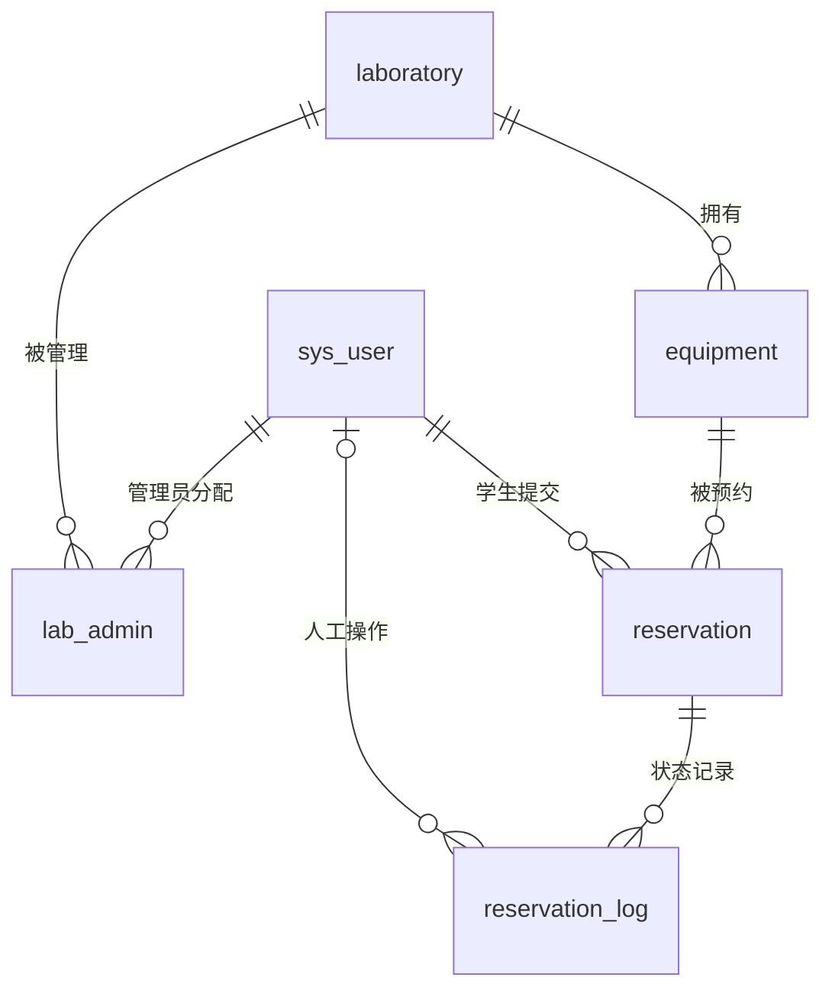

# 数据库设计方案

## 1. 约定与范围

本文件是逻辑及物理设计方案，不是已执行的建库脚本。阶段 1 通过 Flyway 实现版本化迁移。采用 MySQL 8、InnoDB、utf8mb4；普通中文文本使用 utf8mb4_0900_ai_ci，账号、编号、openid、幂等键等身份字符串使用大小写敏感的二进制排序规则并在服务端规范化。

主键为 BIGINT 自增，API 一律以十进制字符串传输，避免 JavaScript 精度丢失。时间使用 DATETIME(3)，存北京时间，created_at、updated_at 非空由应用统一填充。关联使用外键 RESTRICT，禁止级联删除业务历史。不设计通用逻辑删除字段，账号和资源通过停用保留。

表中除明确标注可空外字段均非空。所有长度限制同时由接口验证；核心枚举及时间顺序由 CHECK 约束补强，MySQL 最低版本需支持有效执行 CHECK（8.0.16 及以上）。

## 2. 实体关系

管理员分配只允许 LAB_ADMIN 账号，预约申请人只允许 STUDENT，由事务服务校验。角色不可修改，避免分配关系和历史身份失真；系统管理员通过创建新账号调整职责。

## 3. 表设计

### 3.1 sys_user（账号）

| 字段 | 类型 | 约束与含义 |
| --- | --- | --- |
| id | BIGINT | 主键 |
| username | VARCHAR(64) | 唯一；学生使用学号，管理员使用账号 |
| password_hash | VARCHAR(100) | BCrypt 哈希，禁止明文 |
| real_name | VARCHAR(50) | 姓名；仅授权范围展示 |
| role | VARCHAR(20) | STUDENT / LAB_ADMIN / SYS_ADMIN |
| enabled | TINYINT | 默认 1；只允许 0 或 1 |
| wx_openid | VARCHAR(128) | 可空、唯一；仅学生允许绑定，不返回普通接口 |
| created_at / updated_at | DATETIME(3) | 创建及更新时间 |

账号不物理删除，不修改 username、role；允许更改姓名、重置密码及启停。账号停用不自动删除或撤销预约。

### 3.2 laboratory（实验室）

| 字段 | 类型 | 约束与含义 |
| --- | --- | --- |
| id | BIGINT | 主键 |
| code | VARCHAR(32) | 唯一编号，创建后不可改 |
| name | VARCHAR(100) | 名称 |
| location | VARCHAR(200) | 地点 |
| description | VARCHAR(1000) | 可空，说明 |
| enabled | TINYINT | 默认 1，0 或 1 |
| created_at / updated_at | DATETIME(3) | 时间 |

开放时间和预约规则暂作为后端固定配置，不增加复杂规则表。

### 3.3 lab_admin（实验室管理员分配）

| 字段 | 类型 | 约束与含义 |
| --- | --- | --- |
| lab_id | BIGINT | 外键 laboratory.id |
| user_id | BIGINT | 外键 sys_user.id |
| created_at | DATETIME(3) | 分配时间 |

联合主键 (lab_id,user_id)，额外索引 (user_id,lab_id)。使用替换分配接口时事务锁实验室行，服务端校验账号角色及启用状态。审批及实验室编辑也持有该实验室锁，避免权限撤销与操作交错。

### 3.4 equipment（设备）

| 字段 | 类型 | 约束与含义 |
| --- | --- | --- |
| id | BIGINT | 主键 |
| lab_id | BIGINT | 外键 laboratory.id；创建后不可迁移 |
| asset_no | VARCHAR(64) | 全局唯一资产编号，创建后不可改 |
| name | VARCHAR(100) | 名称 |
| category | VARCHAR(20) | INSTRUMENT / COMPUTER / TOOL / OTHER |
| model | VARCHAR(100) | 可空，型号 |
| location | VARCHAR(200) | 存放位置 |
| description | VARCHAR(1000) | 可空，说明 |
| status | VARCHAR(20) | AVAILABLE / MAINTENANCE / DISABLED |
| created_at / updated_at | DATETIME(3) | 时间 |

索引 (lab_id,status,id)。不提供物理删除，退出使用采用 DISABLED。

### 3.5 reservation（预约）

| 字段 | 类型 | 约束与含义 |
| --- | --- | --- |
| id | BIGINT | 主键，对外预约标识 |
| equipment_id | BIGINT | 外键 equipment.id，创建后不可变 |
| student_id | BIGINT | 外键 sys_user.id，创建后不可变 |
| start_time / end_time | DATETIME(3) | 预约区间，CHECK start_time < end_time |
| purpose | VARCHAR(500) | 用途，不允许空白 |
| status | VARCHAR(20) | PENDING / APPROVED / REJECTED / CANCELLED / EXPIRED / COMPLETED |
| idempotency_key | VARCHAR(64) | 客户端 UUID；与 student_id 构成唯一键 |
| request_hash | CHAR(64) | 标准化设备、时间、用途字段的 SHA-256，用于同键不同内容检测 |
| created_at / updated_at | DATETIME(3) | 时间 |

索引：唯一 (student_id,idempotency_key)；(equipment_id,status,start_time,end_time) 用于冲突；(student_id,status,end_time) 用于配额；(status,start_time,id) 用于过期扫描；(created_at,id) 用于统计及全局列表。实验室筛选通过设备关联，不冗余 lab_id。索引效果在后续使用 EXPLAIN 和实际数据验证，不能声称已优化。

普通唯一键无法表达任意时间交叠；必须采用架构文档规定的设备行锁和事务查询。所有申请和处理在锁定设备后执行，不能只依赖上述复合索引。

### 3.6 reservation_log（预约状态日志）

| 字段 | 类型 | 约束与含义 |
| --- | --- | --- |
| id | BIGINT | 主键 |
| reservation_id | BIGINT | 外键 reservation.id |
| operator_id | BIGINT | 可空，外键 sys_user.id；系统过期任务为空 |
| action | VARCHAR(20) | CREATE / APPROVE / REJECT / CANCEL / REVOKE / EXPIRE / COMPLETE |
| from_status | VARCHAR(20) | 可空，仅 CREATE 为空 |
| to_status | VARCHAR(20) | 变更后状态 |
| reason | VARCHAR(500) | 可空；REJECT、REVOKE 必填 |
| created_at | DATETIME(3) | 操作时间 |

索引 (reservation_id,created_at,id)。只追加，禁止常规接口更新或删除。操作者为空时 action 必须为 EXPIRE；其他操作记录用户 ID。审批意见从日志读取，不在预约主表维护另一份容易失配的状态意见。

### 3.7 wx_bind_ticket（短效微信绑定凭证）

| 字段 | 类型 | 约束与含义 |
| --- | --- | --- |
| ticket_hash | CHAR(64) | 主键；原始凭证用安全随机数生成，只返回一次 |
| wx_openid | VARCHAR(128) | 微信服务端返回值，不回传客户端 |
| expires_at | DATETIME(3) | 5 分钟有效期 |
| created_at | DATETIME(3) | 创建时间 |

索引 (expires_at)。绑定事务锁凭证后验证有效期、学生账号密码和唯一绑定关系，更新账号并删除凭证；失败不创建绑定。过期记录定时清理。该表不保存 session_key 或 AppSecret，不与业务用户建外键，因为凭证产生时尚未匹配账号。

## 4. 一致性和事务

- 事务隔离 READ COMMITTED，锁顺序：实验室 → 设备 ID 升序 → 学生账号 ID 升序 → 预约。资源 ID 关联不允许修改。
- 账号配额统计：student_id 匹配，end_time > 当前时间，且 status 为 APPROVED 或（status 为 PENDING 且 start_time > 当前时间）；不在配额统计事务中跨设备更新过期记录。
- 账号启停在账号行锁内更新；预约持有学生锁后再次检查 enabled。实验室分配在实验室锁内更新，所有受分配约束的写操作持锁后重新校验分配。
- 预约变更和日志同一事务；写入失败全部回滚，不留下无日志状态或无预约日志。
- 唯一键失败转换成明确业务冲突或幂等重放；死锁和锁超时回滚后提示可重试。
- 时长、半点对齐、每日开放、7 天窗口、用途及状态前态由服务端校验，不能仅依赖数据库约束。

## 5. 迁移和演示数据计划

阶段 1：V1 建账号、实验室、分配及设备等基础表，预约相关表可在阶段 3 通过新增版本创建；实际顺序以依赖完整和阶段范围为准。开发演示数据与正式迁移区分，提供明确的开发配置开关及脱敏数据，不自动注入生产账号密码。后续迁移只新增版本，不修改已应用文件；备份和恢复在部署阶段验证。本阶段不生成 SQL，也不宣称数据库已建成。
